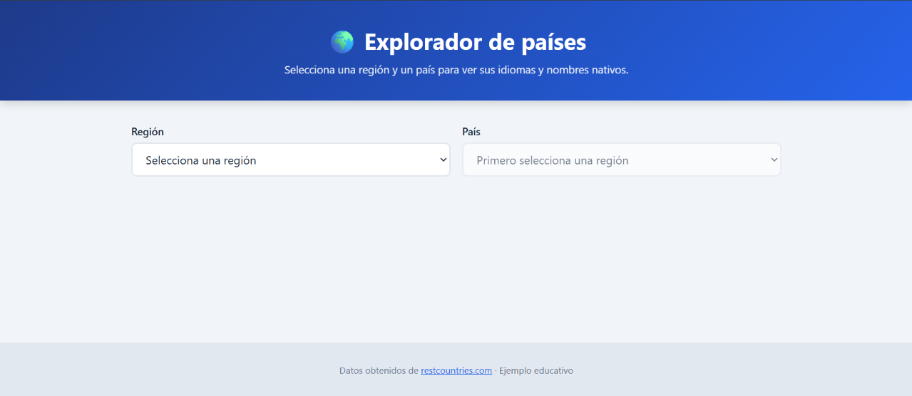

# 🌍 Explorador de países · REST Countries

Aplicación web que consume la API pública [restcountries.com v3.1](https://restcountries.com/) para mostrar, mediante dos listas desplegables y una tabla, los **idiomas** y el **nombre nativo** de cualquier país del mundo.


---

## 🚀 Demo


---

## 📁 Estructura del proyecto

```
.
├── index.html          # Interfaz
├── css/
│   └── styles.css      # Estilos
├── js/
│   └── main.js         # Lógica de la aplicación
├── README.md
└── LICENSE             # (opcional)
```

---

## 🧠 ¿Cómo funciona?

1. Al cargar la página, el selector de **Región** se rellena con las regiones disponibles en la API (`africa`, `americas`, `asia`, `europe`, `oceania`, `antarctic`).
2. Al seleccionar una región, se realiza una petición `fetch` a:
   ```
   https://restcountries.com/v3.1/region/{region}?fields=name,languages
   ```
   El parámetro `fields` limita la respuesta a los datos necesarios.
3. La lista de países se ordena alfabéticamente y se vuelca en el selector de **País**.
4. Al seleccionar un país, se construye una tabla con dos columnas:
   - **Idioma**: nombre del idioma oficial.
   - **Nombre nativo**: nombre del país en ese idioma (si está disponible).

---

## ✨ Características

- ✅ 100 % en el cliente (no requiere backend).
- ✅ Consumo de una API REST pública con `fetch`.
- ✅ Manejo de estados de carga y errores.
- ✅ Diseño responsive.
- ✅ Código comentado y fácil de entender.
- ✅ Sin dependencias externas (solo HTML, CSS y JavaScript vanilla).

---

## 🖥️ Ejecución local

> ⚠️ **Importante:** aunque esta app no usa Web Workers, es recomendable servirla por HTTP para evitar problemas de CORS en algunos navegadores.

**Opción A — Python**
```bash
python3 -m http.server 8000
# Abrir http://localhost:8000
```

**Opción B — Node.js**
```bash
npx serve .
```

**Opción C — VS Code**
Instala la extensión *Live Server* y pulsa **"Go Live"**.

---

## 🌐 Publicar en GitHub Pages

```bash
git init
git add .
git commit -m "Explorador de países con REST Countries"
git branch -M main
git remote add origin https://github.com/<tu-usuario>/<tu-repo>.git
git push -u origin main
```

Luego en GitHub:

1. **Settings** → **Pages**.
2. En **Source**, elige `Deploy from a branch`.
3. **Branch:** `main` · **Folder:** `/ (root)`.
4. Pulsa **Save**.

En un par de minutos la app estará disponible en:

```
https://<tu-usuario>.github.io/<tu-repo>/
```

---

## 📚 Endpoints utilizados

| Propósito | Endpoint |
|---|---|
| Obtener países de una región | `GET /v3.1/region/{region}?fields=name,languages` |

Valores válidos para `region`:
`africa`, `americas`, `asia`, `europe`, `oceania`, `antarctic`.

---

## 🧯 Solución de problemas

| Síntoma | Causa probable | Solución |
|---|---|---|
| El selector de países no se llena | Error de red o CORS | Abre la consola (`F12`) y revisa el error. Asegúrate de servir por HTTP. |
| La tabla no muestra nombres nativos | El país no tiene `nativeName` para ese idioma | Es normal; se muestra `—`. |
| La página se ve sin estilos | Ruta incorrecta del CSS | Verifica que `css/styles.css` exista. |

---

## 👤 Autor

**Nicolle Andrea Lozano Vega**
- GitHub: [@nicolle-lo-ve](https://github.com/nicolle-lo-ve)
